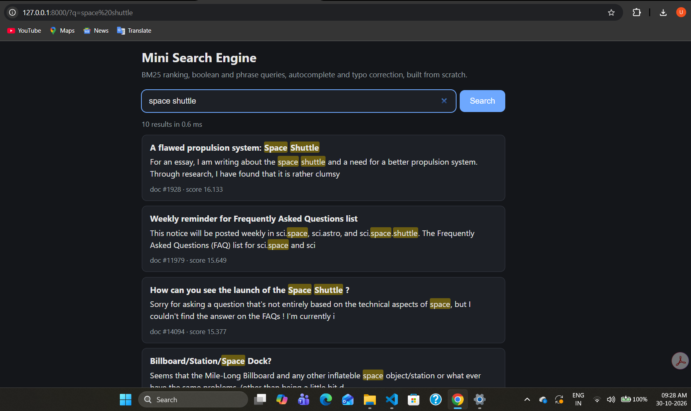
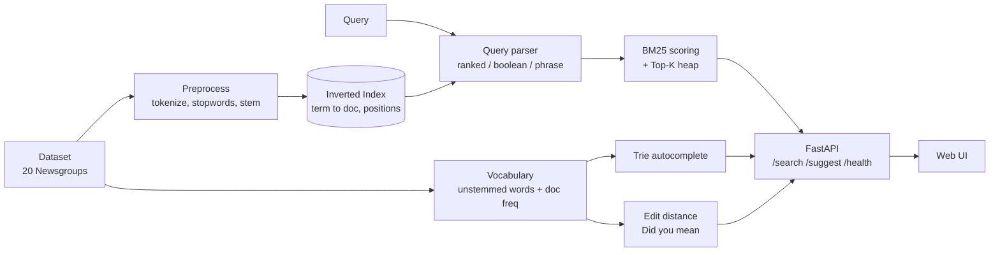

# Mini Search Engine

A search engine built from scratch in Python. No Elasticsearch, no Whoosh: the
inverted index, ranking, query parsing, autocomplete and typo correction are all
written by hand, then served through a FastAPI backend and a small web UI.

**Live demo:** https://YOUR-APP.onrender.com &nbsp;|&nbsp; **Demo video:** YOUR-VIDEO-LINK

> The free hosting tier sleeps after 15 minutes idle, so the first request can take
> up to a minute. The live demo searches a **6,000-document subset** of 20 Newsgroups
> (the free tier has 512 MB RAM). The benchmarks below use the full dataset.



## Features

- **Positional inverted index** with document lengths, saved to disk (pickle)
- **Ranking:** TF-IDF and Okapi BM25 (`k1`, `b` configurable)
- **Top-K** selection with `heapq` (O(n log k)) instead of sorting everything
- **Boolean queries:** `AND`, `OR`, `NOT` using sorted-list merges
- **Phrase search:** `"machine learning"` using positions
- **Autocomplete:** trie with per-node cached top-k, ranked by document frequency
- **Typo correction:** Damerau-Levenshtein over a bucketed vocabulary ("Did you mean")
- **FastAPI** backend with validation, Swagger docs and `took_ms` on every response
- **Web UI** in plain HTML/JS: highlighting, debounced autocomplete, typo hint

## Architecture



## How to run

You need Python 3.12 or newer.

```bash
git clone https://github.com/Udaypratapsingh04/mini-search-engine
cd mini-search-engine
python -m venv venv
venv\Scripts\activate            # macOS/Linux: source venv/bin/activate
pip install -r requirements.txt
python -c "import nltk; nltk.download('stopwords')"
python -m pytest                 # all tests should pass
```

**Quick start (bundled 6,000-doc subset, no download needed):**

```bash
python -m uvicorn app.main:app --reload
```

Open http://127.0.0.1:8000 for the UI or http://127.0.0.1:8000/docs for Swagger.

**Full dataset (about 18K documents, downloads 20 Newsgroups once):**

```bash
python -m src.build_index        # builds data/index.pkl
python -m src.vocab              # builds data/vocab.pkl
python -m uvicorn app.main:app --reload
```

When `data/index.pkl` exists the app uses it; otherwise it falls back to `deploy_data/`.
Set the `DATA_DIR` environment variable to force a folder.

Terminal search without the web server: `python -m src.cli`.

## API examples

```bash
curl "http://127.0.0.1:8000/search?q=space+shuttle&k=5"
curl "http://127.0.0.1:8000/search?q=python+AND+NOT+snake"
curl "http://127.0.0.1:8000/search?q=%22machine+learning%22"
curl "http://127.0.0.1:8000/suggest?prefix=mach&limit=5"
curl "http://127.0.0.1:8000/health"
```

Response shape of `/search` (values are illustrative):

```json
{
  "query": "graphcis card",
  "k": 10,
  "count": 10,
  "took_ms": 3.41,
  "did_you_mean": "graphics card",
  "results": [
    {"doc_id": 123, "score": 7.9421, "title": "...", "snippet": "first 150 characters..."}
  ]
}
```

| Endpoint | Params | Notes |
|---|---|---|
| `GET /search` | `q` (1-200 chars), `k` (1-50, default 10) | ranked, boolean or phrase |
| `GET /suggest` | `prefix` (min 2 chars to get results), `limit` (1-20) | autocomplete |
| `GET /health` | | doc and vocabulary counts |

Invalid input returns HTTP 422. If the index has not loaded yet, endpoints return 503.

## Benchmarks

Measured on the full 20 Newsgroups dataset. Regenerate with:

```bash
python -m benchmarks.readme_table --build-time <seconds from src.build_index>
```

<!-- PASTE docs/benchmark_table.md HERE -->

More detail: `docs/benchmark.md` (latency percentiles), `docs/ranking.md` (TF-IDF vs
BM25, `k1`/`b` sweep). Test coverage: **XX%** (`python -m pytest --cov --cov-report=term-missing`).

## Complexity

| Operation | Time |
|---|---|
| Build index | O(total tokens) |
| Term lookup | O(1) average |
| Boolean AND / OR merge | O(m + n) |
| Top-K selection | O(n log k) |
| Trie prefix lookup | O(p), p = prefix length |
| Levenshtein distance | O(m * n) time, O(min(m, n)) space |

## Limitations

- **Stemming errors:** Porter stemming over-stems ("university" and "universe" both
  become "univers").
- **Stopword position shift:** stopwords are removed before indexing, so the phrase
  "state of the art" behaves like "state art".
- **In-memory index:** the whole index lives in RAM and is loaded from a pickle file,
  so dataset size is limited by memory (the live demo uses a 6,000-doc subset).
- **Query syntax:** no brackets in boolean queries; a phrase must be the whole query.
- **Typo correction** does not fix a wrong first letter and only knows words that appear
  in at least 2 documents.
- **No incremental updates:** adding documents means rebuilding the index.

## Future work

- Compressed postings (delta + variable-byte encoding) to shrink the index
- Bracketed boolean queries and mixed phrase + term queries
- Disk-backed or sharded index for larger collections
- Lemmatization instead of stemming
- Query logging and click feedback for relevance tuning

## Project layout

```
src/         index, tokenizer, BM25/TF-IDF, boolean, phrase, trie, edit distance
app/         FastAPI app (main.py) and search service (service.py)
static/      web UI (index.html)
tests/       pytest suite
benchmarks/  latency, top-K, ranking and README table scripts
scripts/     make_deploy_data.py (builds the bundled subset)
deploy_data/ prebuilt 6,000-doc index used by the live demo
```
